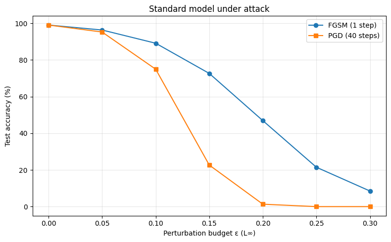
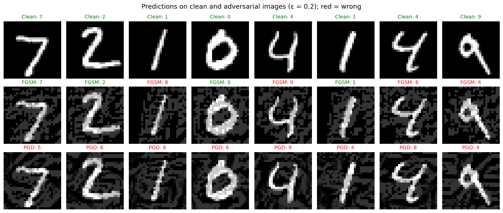
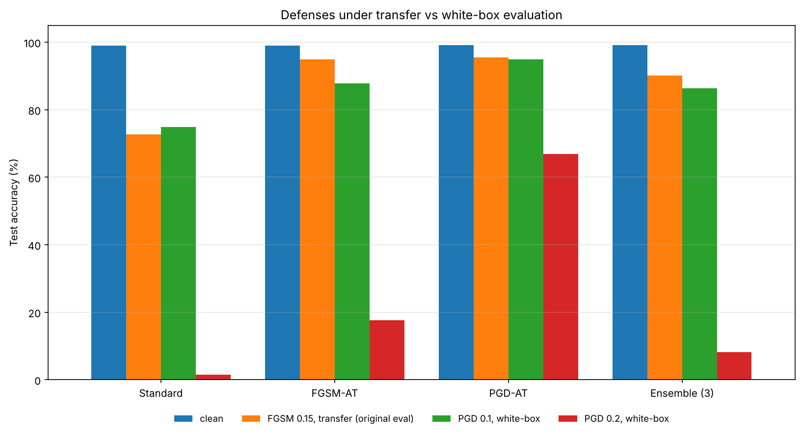

# Adversarial Attacks and Defenses on MNIST

This project tests how well common defenses protect a small MNIST classifier from adversarial examples, and how much that answer depends on the way each defense is evaluated.

It started as a course assignment that implemented FGSM and PGD attacks and three defenses: input quantization, adversarial training and a model ensemble. In that version, the adversarial training and ensemble defenses were tested on attacks crafted against the undefended model and transferred to them. I extended it by attacking each defended model directly (white-box), adding PGD adversarial training, and using an adaptive attack (BPDA) against quantization. The stronger evaluation separates defenses that looked equivalent before: PGD adversarial training stays robust, while FGSM training, the ensemble and 4-bit quantization lose most of their advantage under the strongest attack (PGD at ε = 0.2).

**[Open the notebook →](adversarial_robustness.ipynb)**

## Key findings

1. **PGD is far stronger than FGSM.** At ε = 0.2, FGSM leaves the standard model at 46.9% accuracy, while 40-step PGD drives it to 1.3%. A defense that is only tested against FGSM hasn't been tested against a strong attacker.
2. **Transfer evaluation hides the differences between defenses.** On the original evaluation, FGSM adversarial training (94.9%) and PGD adversarial training (95.5%) look identical. Under white-box PGD at ε = 0.2, they come apart: 17.6% vs 66.9%.
3. **The ensemble mostly benefited from the weak evaluation.** It scored 90.1% on transferred attacks but 8.3% under white-box PGD at ε = 0.2, only slightly better than the standard model's 1.5%.
4. **4-bit quantization is an example of gradient masking.** Attacked naively, it looks almost perfectly robust (99.0%), because rounding has zero gradient and gives the attacker nothing to follow. With BPDA, which passes gradients straight through the rounding step, accuracy falls to 54.0% at ε = 0.1, *below* the undefended model (74.9%).
5. **Among the trained defenses, only PGD adversarial training held up under every attack I tried.** It kept 99.1% clean accuracy and 66.9% under PGD at ε = 0.2, twice the ε it was trained on.

## Results

### Attack strength

| ε | FGSM | PGD |
|---|---|---|
| 0.00 | 99.05 | 99.05 |
| 0.05 | 96.34 | 95.24 |
| 0.10 | 89.13 | 74.95 |
| 0.15 | 72.66 | 22.67 |
| 0.20 | 46.90 | 1.32 |
| 0.25 | 21.47 | 0.00 |
| 0.30 | 8.50 | 0.00 |

Accuracy (%) of the standard model on the full 10,000-image test set.

### Adversarial training and ensembles

| Model | Clean | FGSM 0.15, transfer (original eval) | FGSM 0.1, white-box | PGD 0.1, white-box | FGSM 0.2, white-box | PGD 0.2, white-box |
|---|---|---|---|---|---|---|
| Standard | 99.05 | 72.66 | 89.13 | 74.92 | 46.90 | 1.51 |
| FGSM-AT | 99.06 | 94.94 | 96.44 | 87.84 | 88.27 | 17.60 |
| PGD-AT | 99.10 | 95.49 | 95.91 | **94.89** | 87.28 | **66.93** |
| Ensemble (3) | 99.19 | 90.11 | 91.53 | 86.42 | 54.00 | 8.25 |

FGSM adversarial training is a useful warning sign. It holds up well against FGSM at ε = 0.2 (88.3%) but collapses against PGD at the same budget (17.6%). The model learned to resist the specific one-step attack it was trained on, not small perturbations in general.

### Input quantization

| Bits | ε | No defense | Unaware attacker | Naive white-box | Adaptive (BPDA) |
|---|---|---|---|---|---|
| 4 | 0.1 | 74.90 | 57.60 | 99.01 | 53.96 |
| 4 | 0.2 | 1.43 | 1.60 | 98.97 | 3.00 |
| 1 | 0.1 | 75.09 | 97.06 | 98.78 | 96.48 |
| 1 | 0.2 | 1.38 | 93.73 | 98.71 | 92.85 |

All attacks are PGD. The "naive white-box" column shows why gradient masking is dangerous: it reports near-perfect robustness for both settings, even though the 4-bit version offers no real protection.

The 1-bit result (binarizing each pixel) still holds up under BPDA, which I think is specific to MNIST. Most MNIST pixels are already close to 0 or 1, so a perturbation of 0.2 can only flip pixels that sit near the 0.5 threshold. I wouldn't expect this to carry over to natural images, and a stronger adaptive attack might do better than BPDA here.

## Methods

- **Model:** a two-layer CNN (421K parameters), trained for 3 epochs with Adam. Clean accuracy is about 99%.
- **Attacks:** FGSM (one step) and PGD (40 steps, step size 0.01, random start), both under an L∞ budget ε on pixels in [0, 1].
- **Adversarial training:** each batch mixes 50% clean loss and 50% adversarial loss, with ε = 0.1. FGSM-AT uses one-step FGSM; PGD-AT uses 7-step PGD with step size ε/4.
- **Ensemble:** three standard models trained from different seeds, combined by averaging logits. The white-box attack targets the averaged output.
- **Quantization:** pixels rounded to 2^bits levels. BPDA replaces the rounding step with the identity function on the backward pass.

## Limitations

- Each configuration was trained once with a single seed, so small differences (around 1 to 2 points) may not be meaningful.
- The PGD attack uses one random start. Stronger evaluations such as AutoAttack or multiple restarts would likely lower the robust accuracies further.
- MNIST is a simple dataset, and results on it often don't transfer to natural images.

## Reproducing

Open [`adversarial_robustness.ipynb`](adversarial_robustness.ipynb) in Google Colab, select **Runtime → Change runtime type → T4 GPU**, then **Runtime → Run all**. It takes about 10 to 15 minutes and needs no API keys. The `results/` folder has every table as CSV.

## Background

This project started as a course assignment on adversarial attacks and defenses. I extended it with PGD adversarial training, white-box and adaptive (BPDA) evaluation, and the comparison against the original transfer-based evaluation.

## References

- Goodfellow, Shlens and Szegedy (2015). *Explaining and Harnessing Adversarial Examples.* ICLR.
- Madry et al. (2018). *Towards Deep Learning Models Resistant to Adversarial Attacks.* ICLR.
- Athalye, Carlini and Wagner (2018). *Obfuscated Gradients Give a False Sense of Security.* ICML.
- Xu, Evans and Qi (2018). *Feature Squeezing: Detecting Adversarial Examples in Deep Neural Networks.* NDSS.
